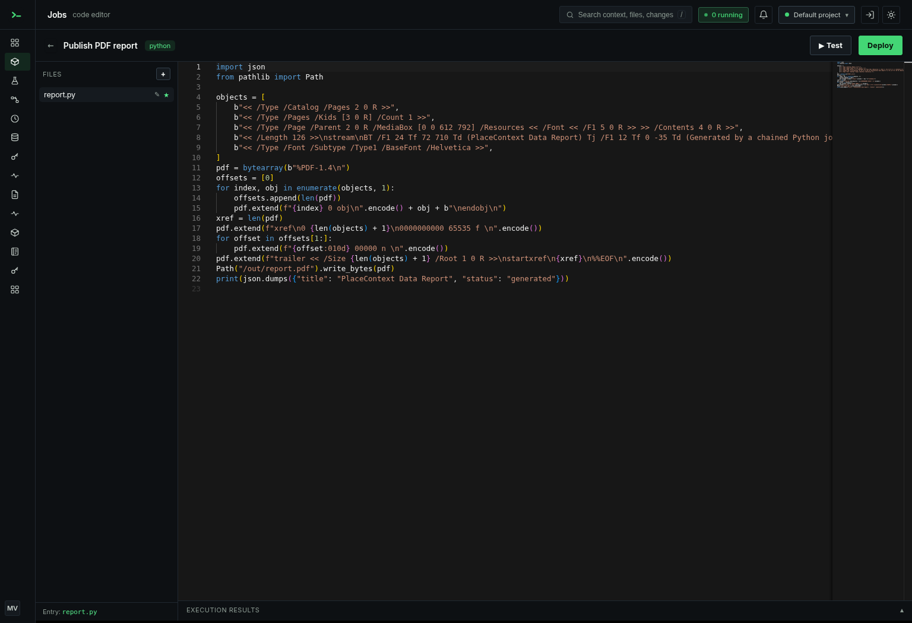
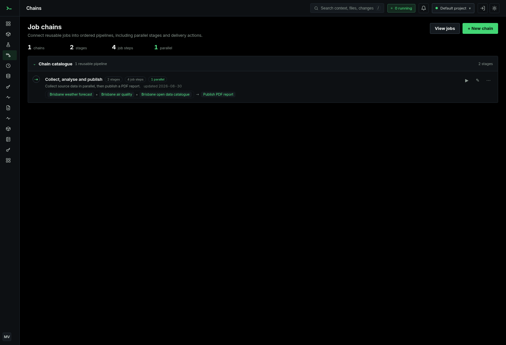
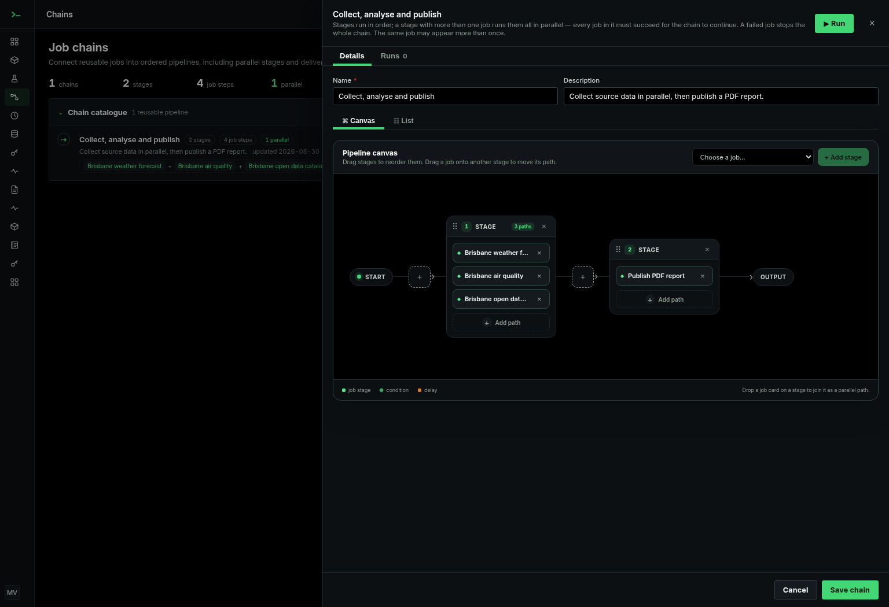
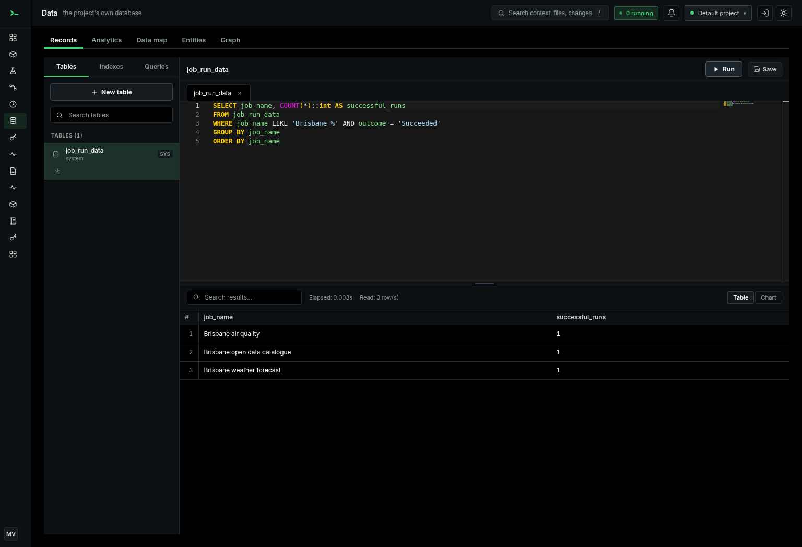
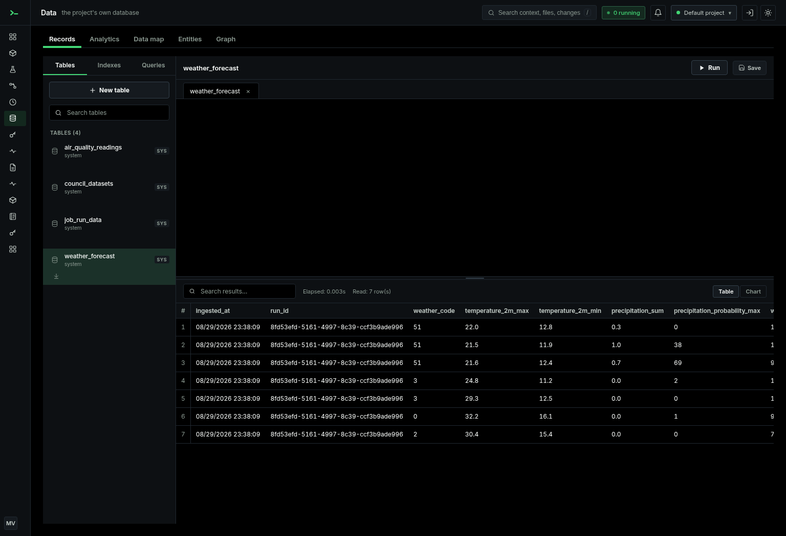
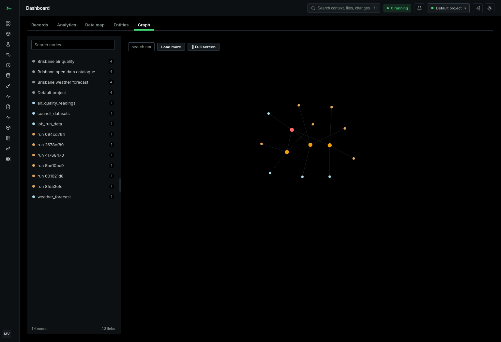
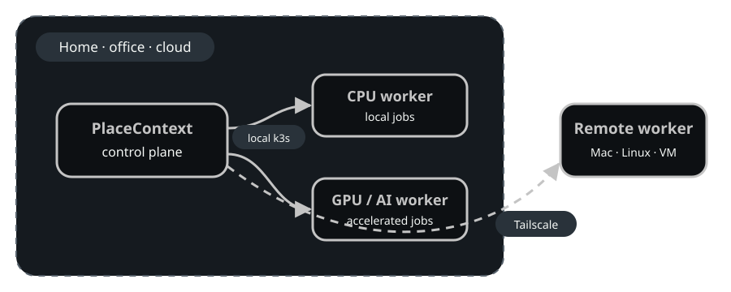

<p align="center">
  
</p>

<h1 align="center">PlaceContext</h1>

<p align="center">
  <strong>A data workflow engine for ingesting, transforming, validating, and delivering data.</strong>
</p>

<p align="center">
  <a href="https://github.com/bradlnz/placecontext/releases/latest"></a>
  <a href="LICENSE"></a>
  
</p>

PlaceContext is an open-source data workflow engine with a web portal and an MCP endpoint. Run work on
demand, on schedules, or from events; fan it out across your fleet; connect jobs into pipelines; and keep the
resulting data, logs, traces, and artifacts under your control.

## Quick start

```bash
# Install prerequisites, create local k3d, and pull the verified GHCR image
curl -fsSL https://get.placecontext.io/install.sh | bash
# portal http://localhost:7700 · MCP /mcp
```

Requires Linux or macOS with `curl`. On Linux it uses an accessible system Docker daemon or uses
passwordless `sudo` to install and start Docker, then activates Docker-group access for the invoking
user. On macOS it uses Docker/Colima through Homebrew. AI features use model connections configured
in **Settings → Models**; the installer does not install an inference worker.
PlaceContext uses [k3s](https://k3s.io), a lightweight Kubernetes distribution, to schedule isolated jobs
across the fleet. For the quick start, [k3d](https://k3d.io) runs k3s inside Docker so no existing Kubernetes
cluster is required. The installer pulls the versioned multi-architecture
[PlaceContext image from GHCR](https://github.com/bradlnz/placecontext/pkgs/container/placecontext).

## Workflow-first platform

PlaceContext is a data workflow engine that runs locally or in the cloud. **Build** creates and edits executable pipelines,
**Workflows** is the canonical place to manage stages, conditions, human approvals,
execution and monitoring. The built-in **Runs** tab shows live status, step progress, inputs
requiring human review, failures and run history. **Observability** provides deeper logs,
traces and execution evidence; the home **Workflow overview** retains quick actions.

Connect data and services as workflow inputs. Create jobs and compose them into flows; use
AI verification when evidence is uncertain, and durable human-input steps for consequential
approvals. An AI assessment is not itself approval or permission to run external actions.

The separate **Workflow store / Agent Store** and **My dashboards / Data profiles** pages
are retired from the product navigation. Their old URLs redirect to Workflows or the Workflow
overview. Existing tenant/project/user records and prior executions are preserved; the underlying
services are retained for compatibility pending a separately planned data-retention migration.
No saved data is deleted by the navigation change. The workflow editor and Build no longer expose
library-agent purchase/simulation actions as a primary workflow.

## Job + data workflows

PlaceContext combines isolated jobs and project-owned data into durable workflows. Add a
**Validate data contract** job between ingestion and downstream actions to enforce required
fields, field types, row count, null-rate and unique-key rules. Failed data checks stop later
workflow stages and produce structured evidence instead of silently forwarding invalid rows.

The workflow editor offers **Pre-run checks** for job source readiness and human
approval gates. Workflow edits carry an expected revision, protecting against silent
concurrent overwrites. These are foundational safety features, not a complete deployment
promotion system. See [the SaaS job/data foundation](docs/job-data-saas-foundation.md) for
current functionality and remaining SaaS work.

## Connect your AI harness

PlaceContext exposes the same tools at `<workspace-url>/mcp`. These examples connect to the local quick-start
instance; replace `http://localhost:7700` with your workspace URL.

### Codex

```bash
codex mcp add placecontext --url http://localhost:7700/mcp
```

### Claude Code

```bash
claude mcp add --transport http placecontext http://localhost:7700/mcp
```

### Google Antigravity

Open **MCP Servers → Manage MCP Servers**, add a custom server named `placecontext`, and set its URL to:

```text
http://localhost:7700/mcp
```

### Hermes Agent

```bash
hermes mcp add placecontext --url http://localhost:7700/mcp --auth oauth
hermes mcp test placecontext
```

The first tool call opens a browser to sign in with OAuth 2.1 + PKCE. Once connected, try:

```text
Onboard this repository into PlaceContext, then show me its recent activity and available jobs.
```

## Why PlaceContext

- **Project databases and entity models** — create project-scoped SQL tables, define linked entities, browse
  records, map job outputs into tables, and explore relationships without mixing tenant data.
- **Containerised compute** — upload code (`python`, `node`, `go`, `ruby`, `dotnet`) or use a container image;
  PlaceContext fans out sandboxed shards across your fleet, collects results and logs, and persists outputs.
- **Worker networking** — manage VPCs, security groups, and job assignments in separate Networking tabs.
  Kubernetes workers use Kube-OVN for private IPv4 allocation and per-run NetworkPolicies for allowed
  CIDRs and TCP/UDP ports. Unsupported workers reject assigned jobs. See the
  [worker networking guide](src/PlaceContext.Host/Wiki/worker-networking.md) for cluster setup and limits.
  The Network flow canvas shows inbound/outbound rules and assigned jobs. Check an IPv4 flow against
  saved rules or run a temporary outbound TCP probe using the selected VPC and security group.
- **Services** — open **Infrastructure → Services** to launch long-running web app or worker images on
  a Docker host. Services survive portal restarts, restart unless stopped, and expose start/stop/restart,
  removal, status, image health, and bounded logs. Each service has its own network and resource limits;
  web ports bind to host localhost. Images must support non-root execution and a read-only root filesystem
  with writable `/tmp`. Environment variables are stored in Docker, visible to host administrators.
  Apps can submit work to the existing authenticated queue API using a reachable portal URL and API token.
  Kubernetes hosting, public ingress/TLS, persistent volumes, and rolling image updates are not yet supported.
- **Workflows and automation** — pass output through ordered stages, fan out parallel work, add wait or condition
  gates, pause for human or external-agent responses, replay from a failed step, and trigger the whole chain
  on demand, on a schedule, or from an event. In the workflow editor, add a Human in the loop or Agent in the
  loop step with validation instructions and a response field. The configured model generates a question
  from those instructions and the preceding output. Configure `PlaceContext:Qemu:Agent` with a model and
  either the `codex` provider or a `chat-completions` endpoint; question generation does not launch a VM.
  Generation errors fail the step without bypassing review. Human steps accept either a written answer
  or Yes/No buttons; Yes/No answers are JSON booleans, including `false`. The run waits for a fresh response
  through the run panel or `resume_job_chain`; subsequent steps receive that field in the accumulated context. Agent steps
  do not launch an agent automatically. These hand-offs are top-level stages and can have condition gates.
- **QEMU agent steps** — give Jev a browser task with a starting URL and a result to verify.
  Our Rust guest agent controls the image's existing Chromium, with no Python or Node/npm runtime dependency.
  The configured vision model proposes coordinate actions; Jev checks live desktop frames for action approval,
  completion and price evidence. No HTML inspection is used. TypeSafe and vision-model credentials stay on the host. VM disks are disposable, guest networking
  is off by default, and cancellation/timeout stop the VM. Runs return page evidence, a decision
  trace, and replay frames. Configure `PlaceContext:TypeSafe` and a prepared image; use
  `PlaceContext:Qemu:Executor=model` for the older general desktop/terminal agent.
  See the [QEMU guide](deploy/qemu/README.md) for setup, supported controls, and realistic task examples.
  Workflows use `/project/{projectId}/workflows` and Observability uses `tab=workflows&workflowRun={runId}`.
  API trigger/replay endpoints use `/api/v1/workflows/{workflowId}` and cancellation uses
  `/api/v1/workflow-runs/{runId}/cancel`. Existing chain URLs remain compatible aliases.
- **Job logs** — workflow runs and individual job runs include a log event viewer with live updates,
  shard/reduce streams, text search, level filters, line wrapping, pause/resume, and log downloads.
  Filters search the newest 2,000 captured events; the table previews the newest 100 matches with up to
  2,000 characters per message. Downloads include all available output and load only on click. Timestamps
  and levels are shown when emitted by the job. Live output uses the existing per-host buffer;
  completed jobs use retained run logs.
- **Log analytics** — Observability → Logs uses Monaco for command pipelines such as
  `filter level = ERROR | stats count() as errors by job | sort errors desc | limit 20`.
  Select and rename fields with `fields` / `project`; filter with `filter` / `where`; aggregate with
  `stats` / `summarize`; then `sort` and `limit` / `take`. Aggregates include count, distinct count,
  sum, average, minimum, and maximum. Group by fields or UTC time buckets such as `bin(5m)`.
  Azure-style substring conditions support `where message contains "timeout"`, `!contains`, and case-sensitive `contains_cs` / `!contains_cs`, including mapped and JSON fields.
  JSON messages expose nested fields under `json`, for example `stats avg(json.durationMs) by job`.
  Commands execute in order, and result columns follow the query. This is a bounded local pipeline
  language, not a complete KQL or CloudWatch implementation. Existing filter expressions still work.
  Queries cover the latest 100 authorized runs, newest 2,000 events per run, and at most 500 displayed
  rows; aggregations use all loaded events before that display cap. Refresh reruns the query snapshot.
  “Map log fields” maps nested JSON properties into timestamp, level, message, and stream before filtering or aggregating. Blank/missing fields retain detected values; timestamp mappings accept ISO dates. Mappings stay in the current browser session while navigating; original JSON fields and saved logs are preserved.
  The active Observability tab is stored in the URL and survives refresh and browser navigation.
- **Run input files** — the job-run dialog toggles between parameter values (or configured payloads)
  and a JSON file up to 1 MiB. The file must contain an object and required parameters; nested JSON
  is preserved. File input overrides the payload only for that run, leaving job defaults unchanged.
- **Queues** — configure a named queue under a project and link it to a workflow chain. Submit a JSON
  object to `POST /api/v1/queues/{queueId}/messages` using a personal API token with `jobs.run` permission.
  The full object becomes the starting context. A durable HTTP 202 receipt includes a tracking ID and
  `Location` URL (read with `jobs.view`). Optional `Idempotency-Key` values deduplicate retries within
  a queue. Payloads are limited to 1 MiB; names to 120 characters and idempotency keys to 128 characters.
  Pausing rejects new intake; accepted messages retain their original chain. Workers across host replicas
  share PostgreSQL and claim disjoint batches atomically, with heartbeat recovery and the existing
  `PlaceContext:Scheduling:MaxConcurrentChains` limit per replica. This distributes messages dynamically;
  it does not provide fixed partition ownership, per-key ordering, or FIFO execution. Tracking receipts
  expire after a configurable 1–365 days from completion (default 30, hourly cleanup). A message TTL
  of 1–604,800 seconds (default 24 hours) expires waiting messages before dispatch; running workflows
  continue. Default delivery delay is configurable from 0 to 604,800 seconds. Override it for one
  submission with an `X-Execute-At` ISO timestamp up to 365 days ahead; workers never claim it before
  that time. Receipts include `availableAt` and `expiresAt`. TTL starts when a message becomes eligible,
  after its delivery or retry delay. Configure 1–10 total attempts and an initial retry delay of 1–86,400 seconds; the delay
  triples after each failure, capped at 24 hours. Failed workflows restart from the beginning with
  the original payload, including failures after human/agent hand-offs. Make side effects idempotent.
  Exhausted messages retain their encrypted payload for manual retry until receipt cleanup; successful
  and expired messages release it. Previous attempt runs remain linked for inspection.
  Settings are captured on acceptance. Deleting a queue removes intake but preserves
  accepted messages and their receipts. Once a receipt expires, its idempotency key can create a new
  message again. Queue configuration and deletion require `chains.manage` permission.
  The queue list supports search, intake filters, and selection. Each queue has Messages, Monitoring,
  Configuration, and Integration tabs that survive refresh. Monitoring summarizes the latest 50 receipts,
  not the total queue depth. Creation, editing, and deletion use side panes, like other app dialogs.
- **Events** — Activity filters the latest 100 workspace events by project, source, and text, with links
  from system job-completion events to run details and logs. Event types define workspace contracts;
  Subscriptions shows the selected project's event triggers, their enabled state, last firing time,
  and a direct link to manage each job's triggers.
- **Analytics and artifacts** — query project data, create charts and reports, and retain HTML, chart, CSV, and
  structured run artifacts in object storage.
- **Lineage and observability** — inspect job-to-table mappings, run and chain history, shard outcomes, logs,
  OpenTelemetry traces, and operational status across the workspace.
- **Governed access** — project and tenant boundaries, role-based permissions, OAuth 2.1 + PKCE, encrypted
  secrets, and sandboxed jobs with network egress disabled by default.
- **MCP and automation integration** — durable project context and MCP tools let AI and automation clients use
  the same governed data, jobs, pipelines, and artifacts as human operators.

## Screenshots













## Example deployments

The same setup works for homelab automation, project workflows, and local batch processing. For example, a
document chain can receive a file, run OCR, extract structured fields in parallel, store the records, generate a
PDF report, and send a completion message. Each stage receives the previous stage's primary output, while runs,
logs, retries, and artifacts remain visible in one place.



The control plane and workers can run on bare metal, VMs, Macs, Linux servers, cloud hosts, or a mixture of
them. k3s schedules the work; Tailscale can privately connect nodes that are on different networks.

### Mac-led home or studio cluster

- Run the quick-start installer on an always-on Apple Silicon Mac mini.
- Use the generated command in **Cluster → Add node** to join MacBooks or Linux workstations as workers.
- Tailscale lets machines participate from different networks without opening worker ports publicly.

### Single cloud server

Run a small non-HA workspace on an Ubuntu server and keep AI inference disabled until it is configured
from the portal:

```bash
curl -fsSL https://get.placecontext.io/install.sh | bash
```

Point DNS and TLS at the portal, then connect local workers from **Cluster → Add node**. This is a good fit for
evaluation or a small team; production HA uses an existing multi-node k3s cluster, external PostgreSQL, and S3.

### Proxmox homelab

- Run the PlaceContext portal on an always-on Linux VM and create separate worker VMs for local jobs.
- Give CPU-heavy, memory-heavy, or GPU-backed workloads their own workers, then let job chains coordinate them.
- Use schedules for backup checks, media processing, document indexing, sensor rollups, or nightly reports.
- Keep the portal private on the LAN, or use [Tailscale](https://tailscale.com/kb/1017/install) to add workers
  from another site.

A single Proxmox host is an excellent homelab but not HA. A production deployment uses three k3s server VMs
spread across independent Proxmox hosts, separate worker VMs, external PostgreSQL, and off-cluster S3.

In every layout, the portal, schedules, events, and connected AI harnesses submit work to the same durable job
queue. See [`deploy/release/README.md`](deploy/release/README.md) for production requirements and shard options.

## Documentation

- [Installation and fleet setup](deploy/release/README.md)
- [OpenSearch integration](src/PlaceContext.Host/Wiki/opensearch-integration.md)
- [SSO and OAuth integration](src/PlaceContext.Host/Wiki/sso-and-oauth.md)
- [Security and sharing](src/PlaceContext.Host/Wiki/security-and-sharing.md)

The Markdown files under `src/PlaceContext.Host/Wiki/` are embedded into the portal and are the
operator-facing documentation shipped with each build.

## Upgrading

- Re-run the installer to download and verify the newest compiled GitHub release, then roll the deployment.
- Pass `--version v1.2.3` to install or retain a specific release.

## License

**Software:** open source under the MIT License — © Bradley Lietz / CTRL SIGNAL SOFTWARE PTY LTD. See [LICENSE](LICENSE).

**Your data and jobs:** owned by you. PlaceContext does not claim ownership of project data,
knowledge, job definitions, runs, or artifacts you create or import. Details are in [LICENSE](LICENSE).

Third-party components used by PlaceContext are listed in
[THIRD-PARTY-NOTICES.md](THIRD-PARTY-NOTICES.md).

## Contributing and security

Contributions are welcome. See [CONTRIBUTING.md](CONTRIBUTING.md) for the development workflow and
[CODE_OF_CONDUCT.md](CODE_OF_CONDUCT.md) for community expectations. Please report vulnerabilities
privately as described in [SECURITY.md](SECURITY.md).

### Build, run, inspect

Use **Build** to describe the workflow outcome and reuse existing jobs and connectors. Open
**Workflows** to inspect the executable definition, conditions, waits, human-review checkpoints
and run history. The Workflow overview highlights runnable processes; **Observability**
shows execution evidence, failures and timing. Use **Analytics** only where a workflow or
investigation needs a chart; it is not a separate profiling product.

Provider-specific billing simulations and private dashboard layouts are legacy records, not
features to build new process design around. These records remain stored until an explicit
retention/export policy is approved.
