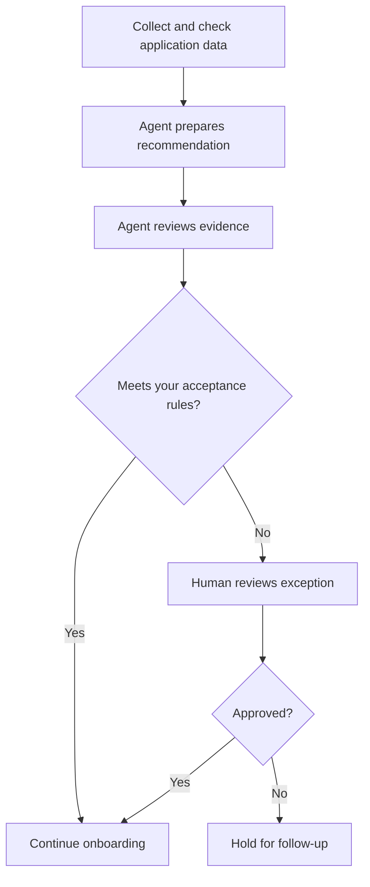

<p align="center">
  
</p>

<h1 align="center">PlaceContext</h1>

<p align="center">
  <strong>Turn your data into action.</strong>
</p>

<p align="center">
  Workflows where data, AI agents, and people work together.
</p>

<p align="center">
  <a href="https://github.com/bradlnz/placecontext/releases/latest"></a>
  <a href="LICENSE"></a>
</p>

PlaceContext is an open-source data and workflow platform for teams that need to turn
information into completed work. Connect your data, give agents a task, and bring people
in when a decision needs their judgement—all within a workflow you can run, inspect, and improve.

Use it to qualify a lead, review a document, prepare a report, or check a software release.
You decide what runs automatically, what needs review, and what happens next.

[Get started](#get-started) · [What you can build](#what-you-can-build) ·
[Agents, people, and decisions](#agents-people-and-decisions) · [Documentation](#documentation)

## From information to completed work

**Give every workflow the context it needs.** Bring together databases, files, and API feeds.
Prepare and query project data, then use those records directly in your workflows. Save the
results back to tables and reports so the next task can build on what you already know.

**Put agents to work.** Ask an agent to research, analyse, write code, or prepare a recommendation.
Combine AI with repeatable jobs, data checks, and browser tasks. Add a separate agent review
to assess the evidence before the workflow moves on.

**Keep people involved where it matters.** Pause for an answer or approval, give the reviewer
the workflow's results, and continue from their response. Make human judgement part of the
process, from an exception review to a final sign-off.

**See what happened and act on it.** Follow progress, inspect outputs and logs, and see which
steps are waiting for input. When work fails, investigate the failed step and replay from there.
Run on demand, on a schedule, or when new work arrives.

## What you can build

These are examples of workflows you can compose with PlaceContext:

| Use case | A workflow you could build | The outcome |
| --- | --- | --- |
| **Lead onboarding** | Gather lead data, check required fields, ask an agent to recommend the next step, and request approval for exceptions. | A reviewed lead ready for follow-up. |
| **Document processing** | Extract records, validate them, route ambiguous results to a person, and save the accepted data. | Structured information ready to use. |
| **Research and reporting** | Collect sources in parallel, analyse the findings, review the evidence, and generate a report. | A repeatable reporting process with inspectable results. |
| **Software delivery** | Assign implementation work, run tests, request an independent agent review, check the browser experience, and ask for sign-off. | A reviewable handoff with test and review evidence. |

Explore the [build-and-verify example](examples/real-estate-sdlc/README.md) for a workflow that
combines agent tasks, independent review, browser checks, and a readiness assessment.

## Agents, people, and decisions

An agent can prepare the work. Another agent can review it. A person can approve it.
Your workflow decides how those responses affect the next action.

| Concept | What it does | Example |
| --- | --- | --- |
| **Agent task** | Gives an agent work to complete. | Review an application and prepare a recommendation. |
| **Agent in the loop** | Adds an AI review or assessment at a checkpoint. | Check whether the recommendation is supported by the evidence. |
| **Human in the loop** | Pauses for a person's answer or approval. | Resolve missing information or approve an exception. |
| **Decisions** | Routes work using recorded results and rules you choose. | Continue when checks pass; request review when they do not. |

For example, an onboarding workflow can send routine cases forward and ask a person to review exceptions:



You configure the checks, approval steps, and both decision paths. An AI recommendation is an
input to that process; actions that need human approval must depend on the person's response.
See the [workflow and decision reference](docs/platform-reference.md#decisions-and-human-approval)
for configuration examples.

## Built for work you need to own

- **Data and execution together.** Connect sources, query records, run jobs, and keep their outputs
  in the same project. Use the data you already have to drive the next action.
- **Room for real workloads.** Combine your own code and containers with agents, parallel work,
  quality checks, and browser automation.
- **Your infrastructure and model choices.** Self-host PlaceContext and connect your chosen
  model providers. Project permissions, encrypted secrets, and isolated jobs help control access.
- **Fits your existing tools.** Work in the web portal or connect AI clients such as Codex and
  Claude Code through MCP. APIs and Terraform support integration and repeatable setup.

Browser automation uses disposable QEMU desktops, with live human control when a task needs
help or a login. QEMU is enabled by default; a prepared desktop image and configured models
are required. [Set up browser tasks →](deploy/qemu/README.md)

## Get started

Install on Linux or macOS:

```bash
curl -fsSL https://get.placecontext.io/install.sh | bash
```

Open **http://localhost:7700**, create a project, and start with one useful workflow:

1. **Connect your context.** Add a data source or import records into a project table.
2. **Build the process.** Describe the outcome to the assistant or compose steps in the workflow editor.
3. **Run and review.** Inspect the results, answer any human checkpoints, and add a schedule when ready.

The installer sets up a local container-based environment. It requires `curl` and Docker access;
installing prerequisites may require administrator permissions. For AI features, add a model
connection under **Settings → Models**.

[Installation guide](deploy/release/README.md) ·
[Connect an AI client](src/PlaceContext.Host/Wiki/mcp-and-jobs.md) ·
[Configure models](docs/build-chat.md)

## Documentation

| I want to… | Start here |
| --- | --- |
| Connect and work with data | [Project data, sources, and queries](src/PlaceContext.Host/Wiki/project-data.md) |
| Build and run workflows | [Jobs, workflows, and artifacts](src/PlaceContext.Host/Wiki/jobs-and-artifacts.md) |
| Configure agents, decisions, and execution | [Platform reference](docs/platform-reference.md) |
| Check data quality | [Data contracts and readiness checks](docs/job-data-saas-foundation.md) |
| Integrate with other systems | [Management API](docs/management-api.md) · [Terraform](terraform/README.md) |
| Manage access | [Security and sharing](src/PlaceContext.Host/Wiki/security-and-sharing.md) · [SSO](src/PlaceContext.Host/Wiki/sso-and-oauth.md) |

## Open source. Your work stays yours.

PlaceContext is licensed under the [MIT License](LICENSE). You retain ownership of your data,
job definitions, runs, and artifacts. © Bradley Lietz / CTRL SIGNAL SOFTWARE PTY LTD.

Want to help shape it? See [Contributing](CONTRIBUTING.md) and the
[Code of Conduct](CODE_OF_CONDUCT.md). Report vulnerabilities through the
[security policy](SECURITY.md). [Third-party notices](THIRD-PARTY-NOTICES.md).
