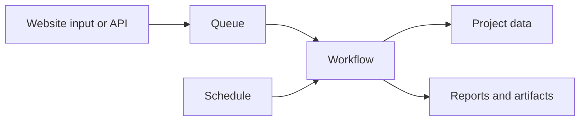
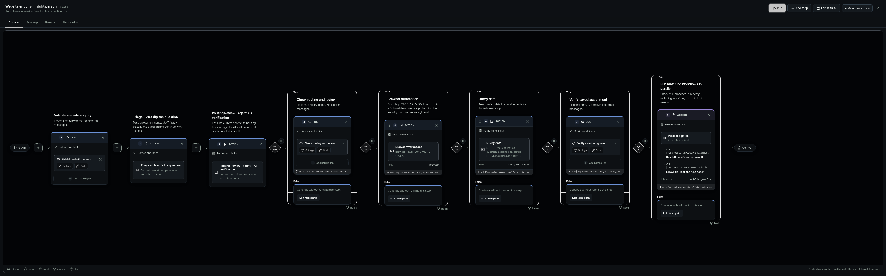

<p align="center">
  
</p>

<h1 align="center">PlaceContext</h1>

<p align="center">
  <strong>Critical work. Connected by context.</strong><br>
  Open-source data, stateless functions and agentic workflows.<br>
  .NET 10 · Blazor · PostgreSQL · Kubernetes · S3-compatible storage
</p>

<p align="center">
  <a href="https://github.com/bradlnz/placecontext/releases/latest"></a>
  <a href="LICENSE"></a>
</p>

Run workflows with agents in the loop. Bring together your data, tools and code, and turn each run into
useful results, reports and files.

Use your own infrastructure, models and tools. Follow each run from its incoming request to its
recorded output, with logs, retries and approval decisions available for inspection.

[Website](https://placecontext.io) · [Get started](#get-started) ·
[Workflow execution](#workflow-execution) · [Architecture](#architecture) · [Documentation](#documentation)

## From input to useful output



| Capability | What you can do |
| --- | --- |
| **Built-in data platform** | Connect sources, clean and map output into project tables, query with SQL and build charts. |
| **Stateless functions** | Run focused code and container jobs with explicit inputs, isolated execution and recorded outputs. |
| **Agents and decisions** | Give agents focused responsibilities, inspect evidence with Determine gates, and pause for human input. |
| **Composable workflows** | Combine sequential stages, parallel branches and reusable sub-workflows in the canvas or YAML markup. |
| **Inputs and scheduling** | Accept website submissions through your backend, queue work and schedule recurring runs. |
| **Data and artifacts** | Retain structured results and generated files; preview, download and share artifacts. |
| **Observability** | Follow workflow and job history, inspect logs and traces, and see failures and retries. |

## Get started

Choose the packaged installation for local evaluation, or clone the repository for development.

### Install with Bash

Run the same installer documented in the [deployment guide](deploy/release/README.md#locallab):

```bash
curl -fsSL https://get.placecontext.io/install.sh | bash
```

The installer verifies a release bundle and runs PlaceContext in a local k3d/Kubernetes cluster
inside Docker. It supports Linux and macOS; Docker access is required, and provisioning Docker
on Linux may require passwordless `sudo`. This is a single-host evaluation installation.
Object storage is optional and must be configured separately.

### Clone and run from source

Prerequisites: Git, Bash, `curl`, a running Docker daemon, and the .NET SDK selected by
[`global.json`](global.json) (10.0.403, with patch roll-forward).

```bash
git clone https://github.com/bradlnz/placecontext.git
cd placecontext
dotnet restore PlaceContext.slnx
./run.sh
```

`run.sh` creates or starts PostgreSQL 17 on `127.0.0.1:5433`, waits for a database query to succeed,
then builds and runs the web host. Database files persist in the `placecontext-dev-postgres`
Docker volume. Stopping the host leaves the database running. If the app is already healthy,
the script exits without restarting it.

Both paths serve the portal at **http://localhost:7700**. The MCP endpoint is `/mcp` and the
management API is under `/api/v1`. Configure model providers in **Settings → Models**.
Codex and Claude Code connections require the CLI to be installed and signed in as the user
running PlaceContext. The release containers do not include these CLIs or inherit your desktop
sign-in; use a provider API connection or prepare an app image with the required CLI and account.
For Ollama and LM Studio, the endpoint must be reachable from the app container; `localhost`
inside a container refers to that container, not your desktop.
Running the source host does not provision a Kubernetes worker cluster, an object store or a
browser VM image; configure those capabilities before running workflows that require them.

For production, use an existing Kubernetes cluster with external PostgreSQL, HTTPS object
storage, TLS and a digest-pinned image. Follow the [production deployment guide](deploy/release/README.md#production-on-kubernetes).
For source development and checks, see [Contributing](CONTRIBUTING.md#development-setup).

## Workflow execution

- Compose sequential stages, parallel branches and sub-workflows in the visual editor, YAML markup or through APIs.
- Browse sub-workflows beneath their callers in the workflow hierarchy; open a row to edit or inspect it.
- Run stateless jobs with explicit inputs, runtime configuration, timeouts and recorded outputs.
- Use conditions and **Determine** gates to select True or False paths; human input steps pause for a response.
- Trigger runs from API requests, queues or schedules. Queue receipts link intake to execution history.
- Inspect per-step status, logs, retries, structured output and artifacts from the run views.

Persistent state belongs in project data and artifact storage. Jobs must not depend on memory or
files from a previous invocation. Delivery retries can repeat external writes; make those writes
idempotent where required.

## Jev reviews

Connect **Jev** to evaluate workflow evidence against explicit questions and scoring criteria.
Use the recorded results for deterministic review rules: a Determine gate selects a path from a
confidence threshold, and scoring gates apply configured weights and minimum scores. The rules
are deterministic; the underlying model assessment is probabilistic and does not guarantee correctness.
Jev also checks proposed browser actions against live desktop frames.

Add `TYPESAFE_API_KEY` to the project's vault, or configure it on the server before starting the host:

```bash
export TYPESAFE_API_KEY='your-typesafe-api-key'
./run.sh
```

The project vault value takes precedence over server configuration. Configure the service's request
and token limits for your account as described in the [platform reference](docs/platform-reference.md#decisions-and-human-approval).
Jev-dependent steps require this key; ordinary conditions and human input steps do not.

## Inside the platform



**Website input → queue → validate → triage → routing review → Determine → assign → verify → parallel handoffs → output.**

The Website Enquiry example routes a question to the right person. Stateless code validates the
input. The Triage and Routing Review sub-workflows query team data and independently assess the
recommendation. Determine evaluates the evidence; ordinary conditions check the recorded results
before browser assignment. The workflow queries and verifies the saved assignment, then runs matching
Handoff and Follow-up sub-workflows in parallel and joins their results.

The screenshot shows the local platform with fictional Northstar enquiry data, captured on
16 November 2026, with the earlier gate labels. The current interface calls the decision gate
**Determine**. The definition has changed since the recorded successful run on 15 November; that
earlier run does not validate later edits.

[Workflow reference](src/PlaceContext.Host/Wiki/jobs-and-artifacts.md#workflows)

## Data that drives the next step

Connect sources, query project tables with SQL, and pass named results between workflow steps.
Clean and validate output, map accepted fields into tables, and turn the stored records into
analytics and charts.

Jobs are **stateless, Lambda-like functions**: explicit input → focused code or a container → recorded
output. Data maps select the accepted output's row path and map named fields into table columns,
retaining run provenance alongside the records.

[Data platform, mappings and analytics](src/PlaceContext.Host/Wiki/project-data.md) ·
[Stateless jobs](src/PlaceContext.Host/Wiki/jobs-and-artifacts.md)

## Build a workflow with multiple agents

Give each agent a focused responsibility: triage, research, review or handoff. The built-in harness
supplies project context and tools, runs model and tool calls, and records outputs for subsequent
steps. Choose the models and instructions each task needs.

The Agents catalogue shows the parent/child hierarchy. Each agent has a workspace for its overview,
instructions, linked workflows, observability, YAML markup, data access and connected tools.
The YAML includes `parentAgentId`, so the reporting relationship is visible in configuration.

Create and operate workflows through chat, the visual editor, APIs or connected MCP clients.
Use sequential stages, parallel work and sub-workflows to compose a larger process.

[Three-agent walkthrough](docs/multi-agent-workflows.md) · [Agents and chat](docs/build-chat.md)

## Agents, people, and decisions

AI review can gather SQL evidence and run validation code before recording an assessment.
**Determine** asks a Yes/No question about the evidence and chooses a True or False path. Conditions evaluate
recorded results; human checkpoints pause for a person's answer or approval.

Configure both paths and gate protected actions explicitly. Retries handle execution failures
within configured limits; they do not replace validation or human approval.

[Reviews and approvals](docs/platform-reference.md#decisions-and-human-approval) ·
[Workflow execution reference](docs/platform-reference.md#decisions-and-human-approval)

## Website inputs, queues and schedules

- **Website inputs:** send form submissions through your backend to a workflow queue. The JSON payload becomes the workflow's starting context.
- **Queues:** configure delivery delay, expiry and retry limits. Inspect message receipts and their linked workflow runs.
- **Schedules:** run the complete workflow at a selected frequency or cron expression, using the workspace time zone and stored inputs.

Keep integration credentials on your server. A receipt confirms intake; the linked run establishes
the outcome. Repeated delivery is possible, so external writes must handle repeated input safely.

[Configure inputs, queues and schedules](src/PlaceContext.Host/Wiki/events-and-schedules.md)

## Data and artifacts you can use

Return structured data for the next step and retain generated files in **Artifacts**. Browse
reports, PDFs, CSVs, charts, HTML, images and video; preview or download the result. Repeated output
from the same job is grouped into versions. Optional public sharing uses expiring, revocable links.

[Jobs and artifact storage](src/PlaceContext.Host/Wiki/jobs-and-artifacts.md#artifacts) ·
[Artifact sharing and access](src/PlaceContext.Host/Wiki/jobs-and-artifacts.md#share-an-artifact-publicly)

## Observability

Follow workflow and job history, compare status and duration, and open a run to inspect its steps,
logs and output. Trace an incoming queue message through execution to the data or artifact it
produced. Live traces show recent execution on the current server replica; recorded run history
provides durable evidence.

[Explore observability](docs/platform-reference.md#execution-and-operations)

## Connect workers and distribute jobs

Add eligible machines as workers and schedule container jobs across local machines, Linux VMs or
cloud infrastructure. Placement follows available capacity and configured node selectors. Use
**Infrastructure → Cluster → Add node** to obtain the join instructions for your environment.

The local installer provides a single-host evaluation cluster. Production deployments use an
existing Kubernetes cluster with appropriate worker isolation, persistent storage and backups.

[Clusters and nodes](src/PlaceContext.Host/Wiki/cluster-and-nodes.md) ·
[Worker networking](src/PlaceContext.Host/Wiki/worker-networking.md) ·
[Production deployment](deploy/release/README.md#production-on-kubernetes)

## What you can build

| Use case | Example workflow | Returned data or artifacts |
| --- | --- | --- |
| **Software & SaaS** | Validate a billing enquiry, review routing, assign it and verify the saved result. | Assignment data and verification evidence. |
| **Manufacturing** | Reconcile production logs and prepare the next shift's handoff. | Production totals and a shift-handoff PDF. |
| **Retail & e-commerce** | Normalize supplier fields, validate products and map accepted data into tables. | Clean product records and validation results. |
| **IT & managed services** | Check a client change and request sign-off before proceeding. | Client change data and an evidence artifact. |
| **Site reliability engineering** | Gather alerts, logs and changes, check service signals and request on-call approval. | Incident evidence and a recovery plan. |
| **Logistics & supply chain** | Normalize carrier events and prepare an exception handoff. | Shipment exception data and a handoff PDF. |
| **Insurance** | Validate claim intake, assess completeness and prepare a case file for review. | Claim intake data and an evidence-pack PDF. |

Industry examples are illustrative patterns. The Website Enquiry walkthrough uses fictional demo data.

## Architecture

| Component | Responsibility |
| --- | --- |
| `src/PlaceContext.Domain` | Entities, value objects, business rules and repository contracts. |
| `src/PlaceContext.Application` | Commands, queries, workflow orchestration and infrastructure interfaces. |
| `src/PlaceContext.Infrastructure` | EF Core persistence, queues, model clients, workload runners and storage adapters. |
| `src/PlaceContext.Host` | ASP.NET Core host, Blazor UI, management API, MCP and authentication endpoints. |
| `src/PlaceContext.DesktopAgent` | Guest agent for browser/desktop automation. |
| `tests` | Layer-specific tests, browser checks and deployment checks. |
| `deploy` | Release installers, Kubernetes resources and VM setup. |

The host exposes the Blazor UI, management API and MCP endpoint. PostgreSQL stores platform state
and project data; Kubernetes executes isolated jobs; configured S3-compatible storage retains
artifacts. AI features use configured model providers.

Dependencies point inward: Application depends on Domain; Infrastructure implements their
contracts; Host composes the runtime. Tenant and project authorization applies at application
and persistence boundaries. See [repository conventions](CONTRIBUTING.md#design-boundaries).

## Documentation

| I want to… | Start here |
| --- | --- |
| Build and run workflows | [Jobs, workflows, and artifacts](src/PlaceContext.Host/Wiki/jobs-and-artifacts.md) |
| Coordinate multiple agents | [Three-agent walkthrough](docs/multi-agent-workflows.md) |
| Connect sources, clean output and build analytics | [Data platform](src/PlaceContext.Host/Wiki/project-data.md) |
| Trigger workflows | [Website inputs, queues and schedules](src/PlaceContext.Host/Wiki/events-and-schedules.md) |
| Inspect execution | [Observability](docs/platform-reference.md#execution-and-operations) |
| Use chat and configure models | [Dashboard chat](docs/build-chat.md) |
| Configure decisions and execution | [Platform reference](docs/platform-reference.md) |
| Check data quality | [Data contracts and readiness checks](docs/job-data-saas-foundation.md) |
| Integrate with other systems | [Management API](docs/management-api.md) · [Terraform](terraform/README.md) |
| Add workers | [Clusters and nodes](src/PlaceContext.Host/Wiki/cluster-and-nodes.md) · [Worker networking](src/PlaceContext.Host/Wiki/worker-networking.md) |
| Manage access | [Security and sharing](src/PlaceContext.Host/Wiki/security-and-sharing.md) · [SSO](src/PlaceContext.Host/Wiki/sso-and-oauth.md) |

## Open source and paid support

The **Developer** offering is free, [MIT-licensed software](LICENSE) that you run on your own
infrastructure with your chosen models, data and tools. You cover infrastructure and model usage.

**Enterprise** support is scoped to your team: deployment planning and setup, workflow and
integration guidance, and operational support for your environment.
[Explore support](https://placecontext.io/#support) · [Discuss support](https://placecontext.io/#contact).

You retain ownership of your data, job definitions, runs and artifacts.
© Bradley Lietz / CTRL SIGNAL SOFTWARE PTY LTD.

Want to contribute? See [Contributing](CONTRIBUTING.md) and the [Code of Conduct](CODE_OF_CONDUCT.md).
Report vulnerabilities through the [security policy](SECURITY.md).
[Third-party notices](THIRD-PARTY-NOTICES.md).
