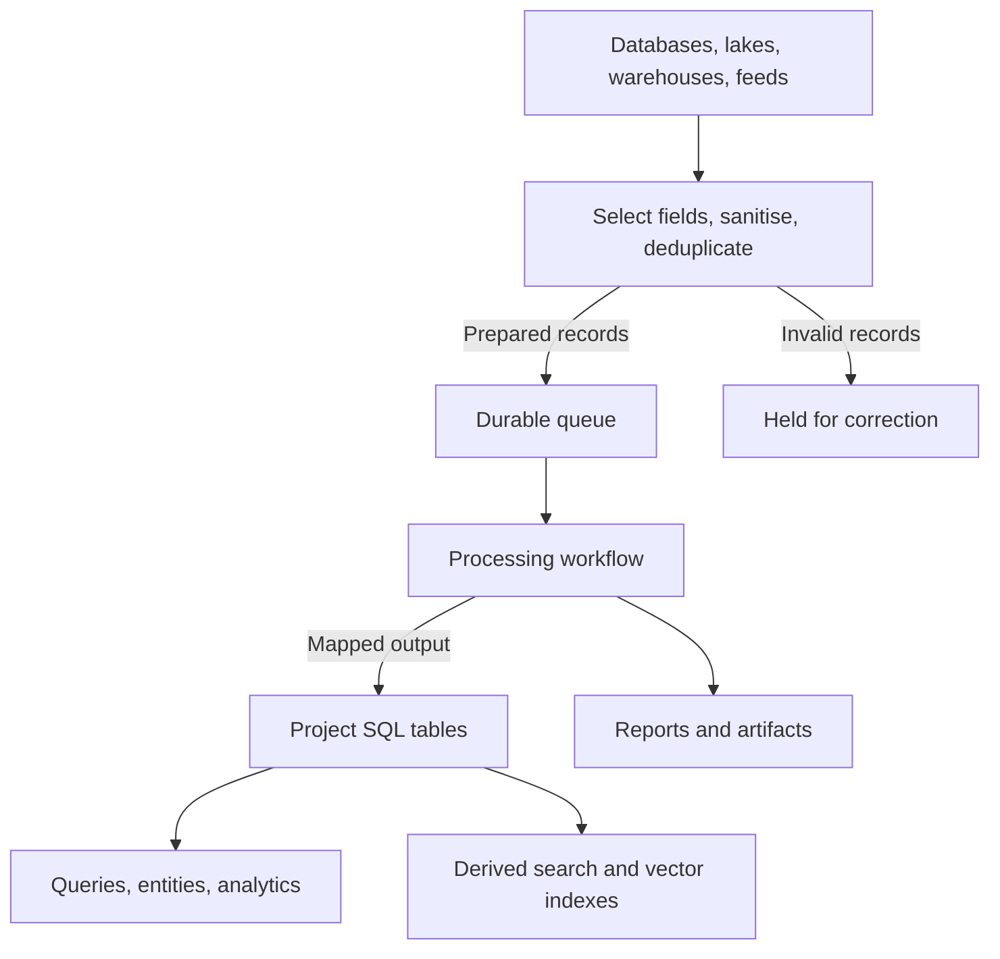
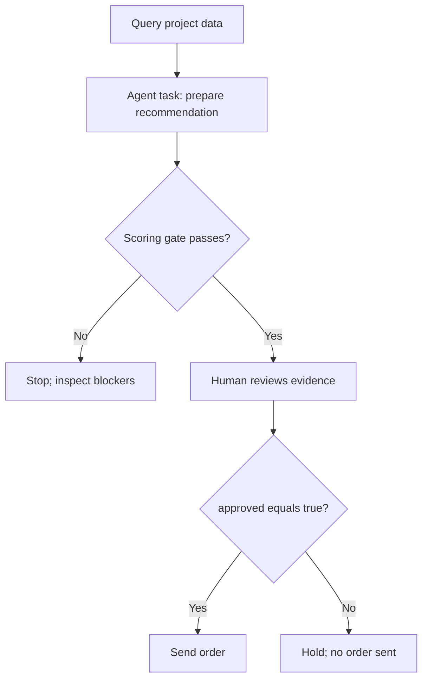
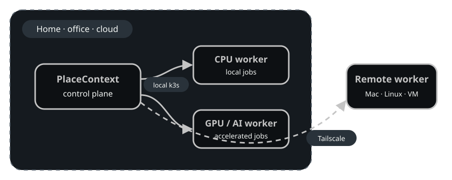

# Platform reference

Implementation details for operators and workflow authors. For a product overview and use cases,
start with the [PlaceContext README](../README.md).

[Data platform](#data-platform) · [Agentic workflows](#agentic-workflows) ·
[Decisions and human approval](#decisions-and-human-approval) · [QEMU setup](#qemu-enabled-by-default) ·
[AI clients](#connect-your-ai-harness) · [Execution and operations](#execution-and-operations) ·
[Deployment examples](#example-deployments)

## Data platform

Connect PostgreSQL, MySQL, SQL Server, S3/MinIO, Azure Data Lake, Fabric/OneLake, Snowflake,
Databricks, or API/event feeds. Source setup discovers datasets, selects a stable key and approved
fields, prepares records, and delivers them to a queue linked to a processing workflow.



| Capability | Current implementation |
| --- | --- |
| Prepare and queue | Keep approved fields, apply explicit field redaction, deduplicate records, and hold invalid rows. Preparation and encrypted queue submissions commit together. Processing, tagging, and retrieval belong in the linked workflow. |
| Project data | Isolated SQL schemas and roles, table editing, CSV import/export, entity relationships, saved queries, and SQL charts. Project tables are the source of truth; indexes are derived retrieval data. |
| Data mapping | Map job or workflow JSON output into typed table columns. Completed runs append mapped rows with run IDs and ingestion timestamps for traceability. |
| Query data step | Browse this project's tables and sample values, select columns and filters, edit SQL, and preview it inside the workflow editor. Execution returns named row objects under a configured field such as `query_data.rows`. |
| Data contracts | The **Validate data contract** job checks required fields, types, row counts, null rates, and unique keys before downstream work. Failed checks stop the workflow and return structured quality evidence. |
| Retrieval and artifacts | Search connected data and project context; opt into embeddings when configured. Keep generated reports and files in artifact storage. Existing source retrieval remains compatible until migrated to queue processing. |

**Query data** uses a read-only project transaction and requires `data.read`. The workflow rejects
truncated results, duplicate column names, and results larger than 1 MiB rather than letting an agent
decide from an incomplete result. Aggregate or narrow large datasets in SQL. Source records and SQL
tables are separate: configure processing and output mappings to move data between them.

See [project data and connector limits](../src/PlaceContext.Host/Wiki/project-data.md) and
[data contracts and readiness checks](job-data-saas-foundation.md).

## Agentic workflows

Compose code jobs, parallel stages, queries, agents, waits, conditions, and human responses on the same
canvas. Each step records its execution and passes results into the workflow context. An agent can do
work, a separate reviewer can assess its evidence, and a human can decide whether the next action runs.

| Concept | How it runs | Result or continuation |
| --- | --- | --- |
| **Agent task** | Assign work and acceptance criteria. **Automatic** runs a selected model connection with project job tools; **External agent** waits for another agent to respond. | Automatic execution stores a JSON object in `task_result` (or your chosen field). External execution requires a fresh written response. |
| **Agent in the loop** | Add a review or reasoning step. Choose **Automatic**, **External agent**, or **AI verification**. | Automatic/external modes return their response; AI verification records the question, model, and probability of Yes in `<response_field>.noul`. |
| **Human in the loop** | Pause for a written answer or Yes/No decision in the run panel or through `resume_job_chain`. | The response is persisted into the chosen field. Yes and No are JSON `true` and `false`; later conditions determine what happens next. |
| **QEMU browser task** | Execute a task in a disposable desktop VM. A vision model proposes actions and Jev checks live frames. | Browser evidence, decision traces, activity, and replay frames; live human control for login/MFA or assistance. |
| **Scoring gate** | Evaluate evidence against weighted criteria, per-criterion minimums, and confidence requirements. | A recorded score, `passed`, blockers, model, evaluation time, and evidence hash. Stops on failure by default. |
| **Condition / Repeat flow** | Branch on recorded values; optionally repeat preceding stages until a completion condition passes. | True/false paths rejoin. Repeat flow is a final stage with 1–10 total attempts; execution failures still stop the run. |

New agent steps default to **Automatic** in the editor. Select an enabled connection and model from
**Settings → Models**. The automatic runner can inspect, author, run, and check project jobs; code executes
through sandboxed jobs. Its tool set does not include host filesystem access or workflow, schedule,
permission, or credential management. It accepts a complete JSON object as the final response and is
bounded to 20 model turns and 30 minutes. Activity and linked job results are visible in the run panel.
Returning JSON completes the agent step; it does not prove that the requested outcome is correct.

For an external hand-off, **Agent task** preserves the assigned instructions. **Agent in the loop** uses
`PlaceContext:Qemu:Agent` to generate a review question from instructions and preceding output, then waits.
Human steps use that question model when configured and otherwise present the supplied instructions.
These steps do not require a VM. AI verification and scoring use the configured TypeSafe/Jev service;
model errors fail the step instead of approving it.

## Decisions and human approval

A decision has explicit evidence, a recorded result, and a rule for the next action. Keep these separate:
an agent's proposal, a model's assessment, a person's approval, and a deterministic branch are different
parts of a workflow.

For example, an order-review workflow can query project data, ask an agent to prepare a recommendation,
score its evidence, and request human approval before sending an order:



Configure the human step as **Yes/No** with response field `approved`, then gate the action with
`eq:approved:true`. **No is a completed response, not an automatic cancellation.** Conditions skip a stage
or take its false path, then rejoin the workflow; gate every later action that depends on approval.

| Decision | Example configuration | Meaning |
| --- | --- | --- |
| Human authorization | `eq:approved:true` | Run the action only after the recorded Yes response. |
| AI evidence threshold | `gte:agent_response.noul:0.9` | Continue only when the model's probability meets the chosen threshold; this is not human approval. |
| Weighted quality result | `eq:release_review.passed:true` | Branch on a scoring gate stored in `release_review`. If **Stop on failure** is disabled, configure the failure path explicitly. |
| Bounded improvement | Repeat flow until `eq:release_review.passed:true` | Repeat earlier work up to the configured attempt limit. Repeated side effects must be idempotent. |

Use **Pre-run checks** to inspect job readiness and missing human gates before execution. Workflow edits
check the revision opened by the editor to prevent silent concurrent overwrites. Run history, saved
context, logs, and review outputs let operators inspect what happened; these checks do not constitute
immutable releases or a complete approval-assignment system.

Project-level decisions also have a separate durable record: MCP `add_decision` stores a question,
choice, and rationale. Recorded decisions and linked changes contribute to the project's decision tree.
These context records document why a choice was made; they do not execute workflow branches.

## QEMU enabled by default

`PlaceContext:Qemu:Enabled` defaults to `true`. The Jev browser executor is the default; native hosts
need QEMU installed, while the packaged runtime image includes it. A workflow only starts a VM when it
reaches a QEMU step with a configured, available image and a ready task agent. Set
`PlaceContext__Qemu__Enabled=false` to disable VM execution explicitly.

Prepare a Debian-compatible x86-64 desktop qcow2 image using the [QEMU guide](../deploy/qemu/README.md),
then configure each process that executes workflows. This example uses a vision-capable chat-completions
provider; replace the endpoint, model, and credential placeholders:

```bash
env 'PlaceContext__Qemu__Images__browser-linux=/absolute/path/browser-linux.qcow2' \
    PlaceContext__Qemu__Agent__Provider=chat-completions \
    PlaceContext__Qemu__Agent__Endpoint=https://your-model-server/v1/chat/completions \
    PlaceContext__Qemu__Agent__Model=your-vision-model \
    PlaceContext__Qemu__Agent__ApiKey=your-model-key \
    TYPESAFE_API_KEY=your-typesafe-key \
    ./run.sh
```

For a container deployment, mount the prepared image and use its absolute **container** path in the
same configuration keys. QEMU executes in the workflow-host process environment, not a Kubernetes job pod.
The installer does not download desktop images or configure providers. Prefer project vault entry
`TYPESAFE_API_KEY` for Jev; host configuration/environment is the fallback. With a local Codex login,
`./deploy/qemu/run-local.sh` configures the standard `dist/qemu/browser-linux.qcow2` image and vision model.

Disks are disposable and guest networking remains off unless enabled on the step. Software emulation
is the default; `PlaceContext__Qemu__UseKvm=true` requires access to `/dev/kvm`. Model credentials stay on
the host. Use **Take control** for login/MFA, **Save login** for an encrypted private browser session,
and **Resume automation** to continue. Cancellation or timeout stops the VM; the timeout includes human
interaction. Live consoles must reach the process executing the VM, with one active VM per host.

## Connect your AI harness

PlaceContext exposes the same tools at `<workspace-url>/mcp`. These examples connect to the local quick-start
instance; replace `http://localhost:7700` with your workspace URL.

### Codex

```bash
codex mcp add placecontext --url http://localhost:7700/mcp
```

### Claude Code

```bash
claude mcp add --transport http placecontext http://localhost:7700/mcp
```

### Google Antigravity

Open **MCP Servers → Manage MCP Servers**, add a custom server named `placecontext`, and set its URL to:

```text
http://localhost:7700/mcp
```

### Hermes Agent

```bash
hermes mcp add placecontext --url http://localhost:7700/mcp --auth oauth
hermes mcp test placecontext
```

The first tool call opens a browser to sign in with OAuth 2.1 + PKCE. Once connected, try:

```text
Onboard this repository into PlaceContext, then show me its recent activity and available jobs.
```

## Execution and operations

- **Project databases and entity models** — create project-scoped SQL tables, define linked entities, browse
  records, map job outputs into tables, and explore relationships without mixing tenant data.
- **Containerised compute** — upload code (`python`, `node`, `go`, `ruby`, `dotnet`) or use a container image;
  PlaceContext fans out sandboxed shards across your fleet, collects results and logs, and persists outputs.
- **Worker networking** — manage VPCs, security groups, and job assignments in separate Networking tabs.
  Kubernetes workers use Kube-OVN for private IPv4 allocation and per-run NetworkPolicies for allowed
  CIDRs and TCP/UDP ports. Unsupported workers reject assigned jobs. See the
  [worker networking guide](../src/PlaceContext.Host/Wiki/worker-networking.md) for cluster setup and limits.
  The Network flow canvas shows inbound/outbound rules and assigned jobs. Check an IPv4 flow against
  saved rules or run a temporary outbound TCP probe using the selected VPC and security group.
- **Services** — deploy long-running apps and workers through Build, inspect status and logs, and
  provision app-owned databases. See [Build and model connections](build-chat.md) for supported
  source deployments, permissions, networking, and persistence requirements.
- **Workflows and automation** — pass output through ordered stages, fan out parallel work, add wait or condition
  gates, run automatic agents, pause for human or external-agent responses, and replay from a failed step.
  Trigger the workflow on demand, on a schedule, from an event, or through a queue. See
  [agentic workflows](#agentic-workflows) for execution modes and [decisions](#decisions-and-human-approval)
  for evidence thresholds, scoring, approval, and branching.
- **QEMU agent steps** — give Jev a browser task with a starting URL and a result to verify.
  Our Rust guest agent controls the image's existing Chromium, with no Python or Node/npm runtime dependency.
  The configured vision model proposes coordinate actions; Jev checks live desktop frames for action approval,
  completion and price evidence. No HTML inspection is used. TypeSafe and vision-model credentials stay on the host. VM disks are disposable, guest networking
  is off by default, and cancellation/timeout stop the VM. Runs return page evidence, a decision
  trace, and replay frames. Configure `PlaceContext:TypeSafe` and a prepared image; use
  `PlaceContext:Qemu:Executor=model` for the older general desktop/terminal agent.
  Execution is enabled by default; see [QEMU setup](#qemu-enabled-by-default) and the
  [QEMU guide](../deploy/qemu/README.md) for image preparation, controls, and task examples.
  Workflows use `/project/{projectId}/workflows` and Observability uses `tab=workflows&workflowRun={runId}`.
  API trigger/replay endpoints use `/api/v1/workflows/{workflowId}` and cancellation uses
  `/api/v1/workflow-runs/{runId}/cancel`. Existing chain URLs remain compatible aliases.
- **Job logs** — workflow runs and individual job runs include a log event viewer with live updates,
  shard/reduce streams, text search, level filters, line wrapping, pause/resume, and log downloads.
  Filters search the newest 2,000 captured events; the table previews the newest 100 matches with up to
  2,000 characters per message. Downloads include all available output and load only on click. Timestamps
  and levels are shown when emitted by the job. Live output uses the existing per-host buffer;
  completed jobs use retained run logs.
- **Log analytics** — Observability → Logs uses Monaco for command pipelines such as
  `filter level = ERROR | stats count() as errors by job | sort errors desc | limit 20`.
  Select and rename fields with `fields` / `project`; filter with `filter` / `where`; aggregate with
  `stats` / `summarize`; then `sort` and `limit` / `take`. Aggregates include count, distinct count,
  sum, average, minimum, and maximum. Group by fields or UTC time buckets such as `bin(5m)`.
  Azure-style substring conditions support `where message contains "timeout"`, `!contains`, and case-sensitive `contains_cs` / `!contains_cs`, including mapped and JSON fields.
  JSON messages expose nested fields under `json`, for example `stats avg(json.durationMs) by job`.
  Commands execute in order, and result columns follow the query. This is a bounded local pipeline
  language, not a complete KQL or CloudWatch implementation. Existing filter expressions still work.
  Queries cover the latest 100 authorized runs, newest 2,000 events per run, and at most 500 displayed
  rows; aggregations use all loaded events before that display cap. Refresh reruns the query snapshot.
  “Map log fields” maps nested JSON properties into timestamp, level, message, and stream before filtering or aggregating. Blank/missing fields retain detected values; timestamp mappings accept ISO dates. Mappings stay in the current browser session while navigating; original JSON fields and saved logs are preserved.
  The active Observability tab is stored in the URL and survives refresh and browser navigation.
- **Run input files** — the job-run dialog toggles between parameter values (or configured payloads)
  and a JSON file up to 1 MiB. The file must contain an object and required parameters; nested JSON
  is preserved. File input overrides the payload only for that run, leaving job defaults unchanged.
- **Queues** — configure a named queue under a project and link it to a workflow chain. Submit a JSON
  object to `POST /api/v1/queues/{queueId}/messages` using a personal API token with `jobs.run` permission.
  The full object becomes the starting context. A durable HTTP 202 receipt includes a tracking ID and
  `Location` URL (read with `jobs.view`). Optional `Idempotency-Key` values deduplicate retries within
  a queue. Payloads are limited to 1 MiB; names to 120 characters and idempotency keys to 128 characters.
  Pausing rejects new intake; accepted messages retain their original chain. Workers across host replicas
  share PostgreSQL and claim disjoint batches atomically, with heartbeat recovery and the existing
  `PlaceContext:Scheduling:MaxConcurrentChains` limit per replica. This distributes messages dynamically;
  it does not provide fixed partition ownership, per-key ordering, or FIFO execution. Tracking receipts
  expire after a configurable 1–365 days from completion (default 30, hourly cleanup). A message TTL
  of 1–604,800 seconds (default 24 hours) expires waiting messages before dispatch; running workflows
  continue. Default delivery delay is configurable from 0 to 604,800 seconds. Override it for one
  submission with an `X-Execute-At` ISO timestamp up to 365 days ahead; workers never claim it before
  that time. Receipts include `availableAt` and `expiresAt`. TTL starts when a message becomes eligible,
  after its delivery or retry delay. Configure 1–10 total attempts and an initial retry delay of 1–86,400 seconds; the delay
  triples after each failure, capped at 24 hours. Failed workflows restart from the beginning with
  the original payload, including failures after human/agent hand-offs. Make side effects idempotent.
  Exhausted messages retain their encrypted payload for manual retry until receipt cleanup; successful
  and expired messages release it. Previous attempt runs remain linked for inspection.
  Settings are captured on acceptance. Deleting a queue removes intake but preserves
  accepted messages and their receipts. Once a receipt expires, its idempotency key can create a new
  message again. Queue configuration and deletion require `chains.manage` permission.
  The queue list supports search, intake filters, and selection. Each queue has Messages, Monitoring,
  Configuration, and Integration tabs that survive refresh. Monitoring summarizes the latest 50 receipts,
  not the total queue depth. Creation, editing, and deletion use side panes, like other app dialogs.
- **Events** — Activity filters the latest 100 workspace events by project, source, and text, with links
  from system job-completion events to run details and logs. Event types define workspace contracts;
  Subscriptions shows the selected project's event triggers, their enabled state, last firing time,
  and a direct link to manage each job's triggers.
- **Analytics and artifacts** — query project data, create charts and reports, and retain HTML, chart, CSV, and
  structured run artifacts in object storage.
- **Lineage and observability** — inspect job-to-table mappings, run and chain history, shard outcomes, logs,
  OpenTelemetry traces, and operational status across the workspace.
- **Governed access** — project and tenant boundaries, role-based permissions, OAuth 2.1 + PKCE, encrypted
  secrets, and sandboxed jobs with network egress disabled by default.
- **MCP and automation integration** — durable project context and MCP tools let AI and automation clients use
  the same governed data, jobs, pipelines, and artifacts as human operators.

## Example deployments

The same setup works for homelab automation, project workflows, and local batch processing. For example, a
document chain can receive a file, run OCR, extract structured fields in parallel, store the records, generate a
PDF report, and send a completion message. Each stage receives the previous stage's primary output, while runs,
logs, retries, and artifacts remain visible in one place.



The control plane and workers can run on bare metal, VMs, Macs, Linux servers, cloud hosts, or a mixture of
them. k3s schedules the work; Tailscale can privately connect nodes that are on different networks.

### Mac-led home or studio cluster

- Run the quick-start installer on an always-on Apple Silicon Mac mini.
- Use the generated command in **Cluster → Add node** to join MacBooks or Linux workstations as workers.
- Tailscale lets machines participate from different networks without opening worker ports publicly.

### Single cloud server

Run a small non-HA workspace on an Ubuntu server and keep AI inference disabled until it is configured
from the portal:

```bash
curl -fsSL https://get.placecontext.io/install.sh | bash
```

Point DNS and TLS at the portal, then connect local workers from **Cluster → Add node**. This is a good fit for
evaluation or a small team; production HA uses an existing multi-node k3s cluster, external PostgreSQL, and S3.

### Proxmox homelab

- Run the PlaceContext portal on an always-on Linux VM and create separate worker VMs for local jobs.
- Give CPU-heavy, memory-heavy, or GPU-backed workloads their own workers, then let job chains coordinate them.
- Use schedules for backup checks, media processing, document indexing, sensor rollups, or nightly reports.
- Keep the portal private on the LAN, or use [Tailscale](https://tailscale.com/kb/1017/install) to add workers
  from another site.

A single Proxmox host is an excellent homelab but not HA. A production deployment uses three k3s server VMs
spread across independent Proxmox hosts, separate worker VMs, external PostgreSQL, and off-cluster S3.

In every layout, the portal, schedules, events, and connected AI harnesses submit work to the same durable job
queue. See [`deploy/release/README.md`](../deploy/release/README.md) for production requirements and shard options.

## Manage as code with Terraform

The workspace management API exposes projects, jobs and schedules for automation. A Terraform provider
lives under [`terraform/`](../terraform/README.md), so workspace definitions can be reviewed, versioned and
applied like any other infrastructure:

```hcl
resource "placecontext_project" "revenue" {
  path = "data/revenue"
  name = "Revenue"
}
```

Point the provider at a workspace origin with a management API key
(`PLACECONTEXT_URL` / `PLACECONTEXT_API_KEY`). See the
[management API reference](management-api.md) for endpoints, permissions and JSON schemas.

## Upgrading

- Re-run the installer to download and verify the newest compiled GitHub release, then roll the deployment.
- Pass `--version v1.2.3` to install or retain a specific release.
- QEMU is enabled when `PlaceContext:Qemu:Enabled` is omitted. Existing explicit `false` settings remain
  disabled; desktop images and model credentials still need configuration on each execution host.
