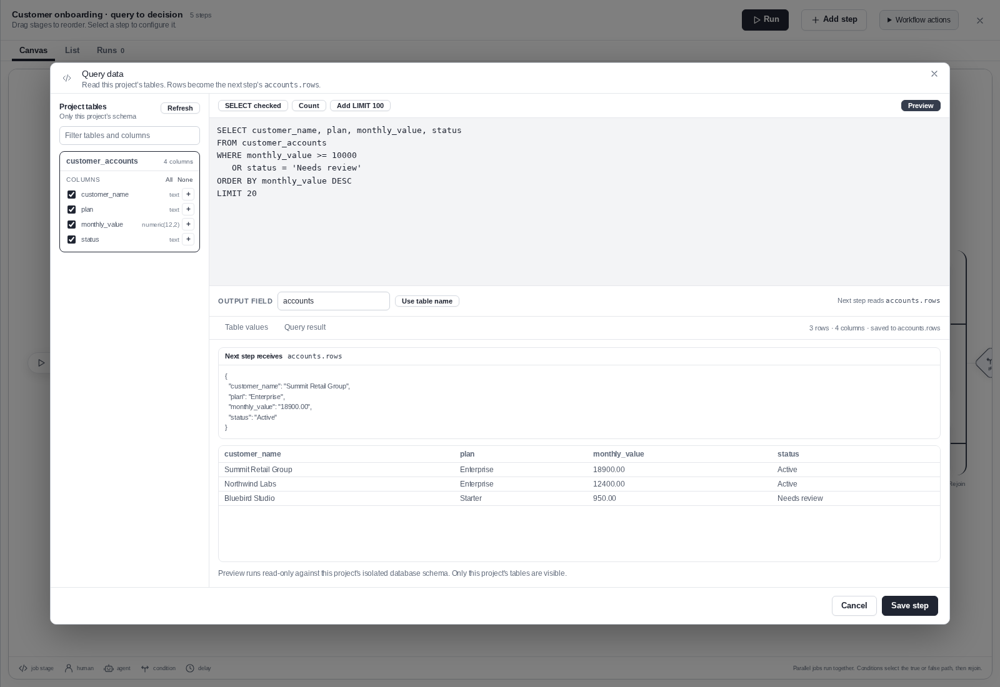
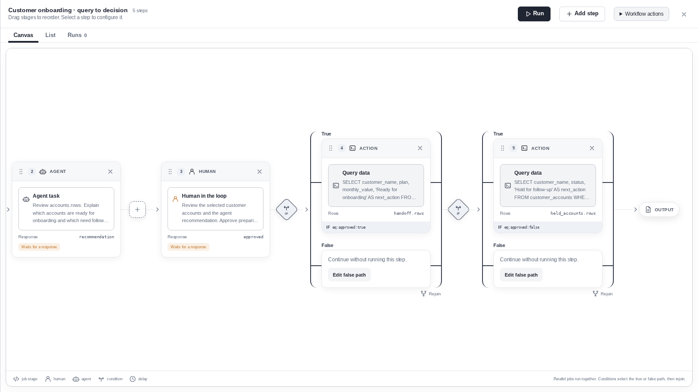
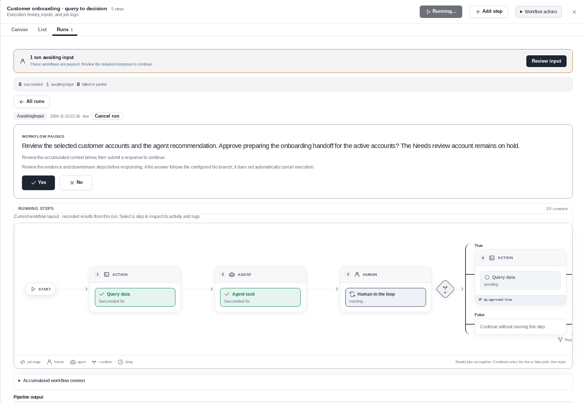
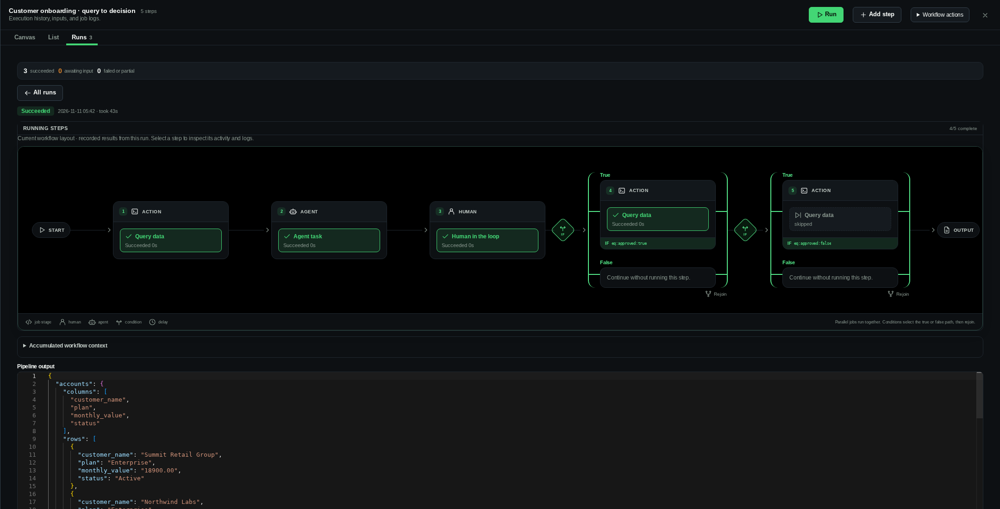

# Workflow example: from data to a decision

A customer-onboarding workflow brings the process together: query the accounts that need attention,
ask an agent to review the evidence, use an AI decision to assess it, and let a person decide whether
to prepare the handoff.
These dark-mode screenshots show one example in the running app with sample customer data.
This example queries accounts before agent review, then queries again after the human decision
to prepare the selected outcome.

### Query data wherever the workflow needs it

Add **Query data** at any stage: gather evidence before an agent task, read records after agent
work, or select the next action's data after a human decision. Browse project tables, choose fields,
filter records, and preview the result. The selected rows become context for subsequent steps.
Here, the opening query finds two active enterprise accounts and one account that needs review.

### Make the decision flow explicit

Follow the complete flow from the initial data query through agent review, AI decision, and human approval.
[The AI decision can use a Jev System One model](https://docs.typesafe.ai/api/system-one) or recorded output from an LLM; either result becomes
workflow data that a condition can route. In this example, a **Yes** selects the onboarding handoff;
a **No** selects the follow-up list. Each condition shows its true and false paths, so you can see what
runs, what is skipped, and where the workflow continues.

### Bring people in at the right moment

The workflow pauses with a visible request for input. Review the results, answer **Yes** or **No**,
and continue from that point. The run keeps the response and shows the steps that already completed.

See the completed run

The approved run completes the handoff query and skips the follow-up query. Run history shows the
chosen path alongside its output, so you can inspect the result and investigate any failed step.

[Capture details](images/workflow-screenshots.md)

[Back to PlaceContext](../README.md)
